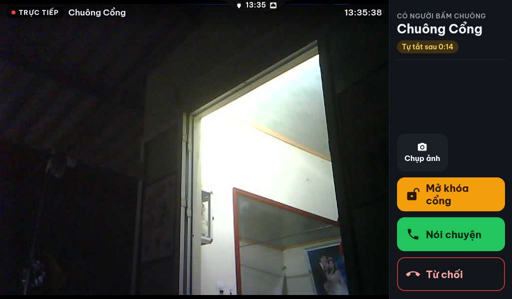

# Hướng dẫn sử dụng Dashboard OS — từ A đến Z

Tài liệu dành cho **người dùng cuối**: từ nhận firmware, cài add-on, cài tích hợp, đến sử dụng hằng ngày và viết
automation. Đọc tuần tự nếu bạn mới bắt đầu; phần cuối là tra cứu nhanh.

> **Dashboard OS gồm 3 thành phần**
> | Thành phần | Chạy ở đâu | Vai trò |
> |---|---|---|
> | **Firmware** | Màn hình ESP32-S3 / ESP32-P4 | Nhận khung hình, vẽ lên màn, nhận cảm ứng |
> | **Add-on** (Dashboard OS Server) | Home Assistant | Chạy Chrome headless, chụp trang web/dashboard, nén khung, gửi xuống màn |
> | **Tích hợp** (custom component) | Home Assistant | Biến mỗi màn thành thiết bị HA: nút bấm, cảm biến, hành động |


---

## 0. Cách hệ thống hoạt động (sơ đồ)

```
┌──────────────┐   WebSocket 8081    ┌─────────────────────────┐   CDP    ┌──────────────┐
│  Màn hình    │ ◄──────────────────►│  Add-on (Chrome headless │ ◄──────► │  Trang web   │
│  ESP32-S3/P4 │   khung JPEG + chạm │  + node server)          │          │  /dashboard  │
└──────────────┘                     └───────────┬─────────────┘          └──────────────┘
       ▲                                        │ HA API
       │ HTTP (chạm/vuốt, chụp)                 ▼
┌──────┴───────┐   hành động / entity  ┌──────────────────┐
│ Tích hợp HA  │ ◄───────────────────► │  Home Assistant  │
└──────────────┘                       └──────────────────┘
```

**Luồng cơ bản**
1. Add-on mở trang web (dashboard HA, hoặc URL bất kỳ) bằng Chrome headless.
2. Chrome chụp khung → add-on nén JPEG ở mức chất lượng/nhịp đã chọn → gửi xuống màn qua WebSocket (cổng 8081).
3. Màn vẽ khung, gửi ngược lại thao tác chạm/vuốt → add-on chuyển thành sự kiện chuột/bàn phím cho trang.
4. Tích hợp HA nói chuyện với add-on qua HTTP để gửi thông báo, đổi cài đặt và đọc trạng thái.

**Vì sao mỗi màn là một thiết bị HA?** Để bạn gán hành động theo từng màn, thấy trạng thái riêng và đưa vào dashboard
HA như mọi thiết bị khác.

## 1. Chuẩn bị

| Hạng mục | Yêu cầu |
|---|---|
| Home Assistant | HA OS hoặc Supervised, kiến trúc **amd64** (bắt buộc — add-on chạy Chrome) |
| Màn hình | ESP32-S3 (480×272, 480×480, 800×480) hoặc ESP32-P4 (1024×600) |
| Mạng | Màn hình và HA cùng một mạng LAN; nên đặt IP tĩnh/DHCP reservation cho từng màn |
| Tài khoản | Quyền admin HA (cài add-on, thêm tích hợp) |

## 2. Nhận firmware và nạp lần đầu

> **Firmware không phát hành công khai.** Liên hệ tác giả để nhận file YAML/`.bin` phù hợp với loại màn của bạn.

1. Liên hệ tác giả, cung cấp **loại màn** (ví dụ `Guition JC4827W543C 480×272`, `Sunton 8048S043C 800×480`, `P4 1024×600`).
2. Nhận file firmware (`.bin` để nạp qua USB lần đầu, hoặc YAML nếu bạn tự build bằng ESPHome).
3. Lần nạp đầu dùng **USB-C** (công cụ như ESPHome Web / esptool).
4. Sau khi nạp, màn hình phát Wi-Fi riêng tên `dashboard-…`: kết nối vào, nhập **Wi-Fi nhà** và **IP máy HA**.
5. Màn khởi động lại, tự kết nối tới add-on (cổng `8081`).

Các lần cập nhật firmware sau: qua **OTA** (Wi-Fi), không cần cắm cáp.

## 3. Cài add-on

1. **Settings → Add-ons → Add-on Store → ⋮ → Repositories**
2. Dán `https://github.com/minhquanghp86/DashboardOS-Server` → **Add**
3. Tìm **Dashboard OS Server** → **Install** (lần đầu tải image ~vài phút)
4. Bấm **Start**, rồi bật **Show in sidebar**

Thanh bên xuất hiện mục **Dashboard**. Mở lên, bạn sẽ thấy:


## 4. Thêm màn hình vào Dashboard

1. Màn hình đã nạp firmware và nhập đúng Wi-Fi + IP HA sẽ **tự xuất hiện** trong mục **Màn hình**
   (chấm xanh = đang kết nối).
2. Nếu chưa thấy: kiểm tra màn cùng mạng, IP HA đúng, rồi khởi động lại màn.
3. Chạm vào thẻ màn hình để mở **trang điều khiển** của màn đó.

## 5. Cài tích hợp vào Home Assistant

### Cách A — qua HACS (khuyến nghị)
1. HACS → **Integrations** → ⋮ → **Custom repositories**
2. Dán `https://github.com/minhquanghp86/DashboardOS-Server`, chọn loại **Integration** → **Add**
3. Tìm **Dashboard OS** → **Download** → **Restart Home Assistant**

### Cách B — thủ công
1. Chép thư mục `custom_components/dashboard_os` vào `/config/custom_components/`
2. Restart Home Assistant

### Thêm tích hợp
1. **Settings → Devices & Services → + Add Integration → Dashboard OS**
2. Giữ địa chỉ mặc định `http://172.30.32.1:18080` → **Submit**

Mỗi màn hình trở thành **một thiết bị** trong HA, tự cập nhật 30 giây/lần.


## 6. Sử dụng hằng ngày trên màn hình

| Thao tác | Kết quả |
|---|---|
| Vuốt từ **đáy** lên | Về màn hình chính |
| Vuốt từ **mép trái/phải** | Quay lại (như nút Back) — xem video ở mục 17 |
| Chạm giữ ứng dụng ở màn hình chính | Vào chế độ sắp xếp: đổi thứ tự, gom thư mục, ẩn/hiện |
| Vuốt từ **trên** xuống | Mở bảng thông báo |
| Không chạm ~1 phút | Vào **màn hình chờ** (đồng hồ, lịch âm, thời tiết, ảnh gia đình) |
| Vuốt lên khi ở màn hình khoá | Mở khoá |


▶ Bốn cử chỉ cơ bản — vuốt ngang chuyển trang · vuốt từ đáy lên về home · vuốt từ trên xuống mở thông báo ·
vuốt lên ở màn khoá để mở — trong một video: [`images/swipe-gestures.mp4`](images/swipe-gestures.mp4) (1,1 MB)


### Màn hình chờ (screensaver)
- Đồng hồ lớn + ngày âm lịch + thời tiết; tuỳ chọn hiện **ảnh nền** (Google Photos hoặc thư mục media).
- Hiệu ứng chuyển ảnh: Mờ dần, Trượt, Thu phóng, Mờ ảo, Chậm (Ken Burns), Xoay vào/ra, Rơi từ trên, Lật 3D.
- Thời gian chuyển ảnh: 5 giây → 5 phút. Chạm vào màn để quay lại.


### Gọi video (P4 ↔ điện thoại ↔ trình duyệt)

**P4**, **ứng dụng Dashboard OS trên điện thoại** và **trình duyệt** đều gọi được vì có **camera + micro**. Các màn S3
**không gọi** được (không có mic/camera) nhưng vẫn **nhận chuông cổng** (xem mục dưới). Chi tiết đầy đủ ở **chương 7**.

**Cách gọi**
1. Trên P4: mở ứng dụng **Cuộc gọi** → danh sách liên hệ hiện các thiết bị có thể gọi.
2. Trên điện thoại: cài **ứng dụng Dashboard OS** (xem 7.3) để chuông reo **kể cả khi app đóng**; hoặc mở
   **Dashboard → Cuộc gọi** trong trình duyệt và **giữ trang này mở**.
3. Chọn bên cần gọi → bên kia đổ chuông → **Nghe** để nói chuyện.
4. Trong cuộc gọi: **Tắt mic**, **Đổi camera**, **Kết thúc**. Cuộc gọi đến hiện **đè lên màn hình khoá** của P4.

> Trang Cuộc gọi trong trình duyệt chỉ nhận cuộc gọi khi **tab còn mở**. Muốn nhận cả khi đã đóng app, dùng ứng dụng
> Android Dashboard OS — chuông do dịch vụ nền lo, không cần mở app. Cài đặt app, bong bóng bánh răng, Chẩn đoán và
> Đăng xuất: **chương 8**. Nhật ký cuộc gọi: **7.9**.

### Chuông cổng có hình (video doorbell)

Khi khách bấm nút chuông ở cổng:

1. **Mọi màn hình được chọn** đổ chuông và hiện **hình camera cổng** toàn màn hình (kèm nút **Trả lời**, **Từ chối**, **Mở cổng**).

   

2. Trả lời → **nói chuyện 2 chiều** với khách ngay trên màn (P4 có micro/loa; S3 chỉ nghe).
3. **Mở cổng** → gửi lệnh mở cổng (thời gian mở đặt được, mặc định 3 giây).
4. Không ai trả lời trong thời gian đổ chuông (mặc định 45 giây) → hệ thống ghi **"cuộc gọi nhỡ"**, gửi thông báo kèm **ảnh người bấm chuông** tới các màn khác.
5. Trang **Dashboard → Chuông cổng** lưu **nhật ký 30 ngày**: giờ bấm, ảnh, ai trả lời, ai bỏ lỡ.

Cấu hình trong **Dashboard → Màn hình → (chọn màn) → Chuông cổng**: chọn màn nào đổ chuông, thời gian đổ chuông, thời gian mở cổng.

### Các ứng dụng có sẵn
Camera (xem/chụp/quay lưu thẻ SD), Frigate, IPTV, YouTube, YouTube TV, nhạc, radio, tin tức, lịch, thời tiết,
ảnh, ghi chú, tệp, gọi video giữa các màn, chuông cửa, báo thức, tin nhắn nội bộ.

  

**Một số ứng dụng trên P4**

| YouTube TV | Tin nhắn |
|---|---|
|  |  |

| Gọi video | Camera |
|---|---|
|  |  |

**Các ứng dụng khác**

| Frigate | Sự kiện camera | Thư viện |
|---|---|---|
|  |  |  |

| Phòng | Solar | TikTok |
|---|---|---|
|  |  |  |

| YouTube Music | Radio | Tin tức |
|---|---|---|
|  |  |  |

| Media | IPTV |
|---|---|
|  |  |


**Báo thức**: đặt trên màn hoặc từ trang Dashboard; lặp theo thứ, báo lại, chọn màn nào reo. Báo thức lưu ở
server nên **màn tắt vẫn reo đúng giờ**.


## 7. Gọi điện giữa các thiết bị (P4 ↔ điện thoại ↔ trình duyệt)

Trong nhà có **ba loại thiết bị** gọi và nhận cuộc gọi video với nhau:

| Thiết bị | Micro | Camera | Ghi chú |
|---|---|---|---|
| **Màn hình P4** (1024×600) | Có | Có | Thiết bị gọi chính; cuộc gọi đến hiện đè màn hình khoá |
| **Điện thoại** — ứng dụng Dashboard OS | Có | Có | Chuông reo cả khi app đóng (xem 7.3) |
| **Trình duyệt** — trang Cuộc gọi | Có | Có (nếu cấp quyền) | Mỗi trình duyệt là **một thiết bị cố định**; cần HTTPS |

Màn S3 (480×272, 480×480, 800×480) **không có micro/camera** nên không gọi được — vẫn nhận chuông cổng như bình thường.

### 7.1. Luồng của một cuộc gọi

```
   P4 (camera + micro)                  Điện thoại (ứng dụng Dashboard OS)
          │                                      │  hỏi server 2 giây/lần
          │                                      │  bấm "Nghe" → mở trang Cuộc gọi
          ▼                                      ▼
   ┌──────────────────────────────────────────────────────────┐
   │            Add-on Dashboard OS — "tổng đài"              │
   │  giữ cuộc gọi · tiếng 2 chiều · hình camera              │
   └──────────────────────────────────────────────────────────┘
          ▲                                      ▲
          │                                      │
   Trình duyệt (tab Cuộc gọi, HTTPS)    Trang Cuộc gọi (quản lý thiết bị)
```

1. Bên gọi chọn một thiết bị trong danh bạ → server **đổ chuông** bên nhận (tối đa 30 giây).
2. Điện thoại: dịch vụ nền phát hiện cuộc gọi trong 2 giây → **màn hình gọi toàn màn + chuông**. P4: cuộc gọi hiện
   **đè lên màn hình**, kể cả khi đang khoá.
3. Bên nhận bấm **Nghe** → hai bên nói chuyện; tiếng đi hai chiều, hình camera đi về phía P4.
4. Bấm **Kết thúc** (hoặc **Từ chối**) → **cả hai bên đóng ngay**, đồng hồ dừng.
5. Không ai nhận trong 30 giây → **cuộc gọi nhỡ**: P4 hiện thông báo, add-on gửi Telegram (nếu đã cấu hình).

> **Rớt mạng vài giây không mất cuộc gọi.** Trang gọi tự nối lại và xin tiếp tục cuộc gọi đang chạy; server chờ
> **6 giây** trước khi coi là "Mất kết nối".

### 7.2. Gọi từ màn hình P4

1. Mở ứng dụng **Cuộc gọi**.
2. Danh bạ hiện mọi thiết bị đang online theo thứ tự **Màn hình → Điện thoại → Trình duyệt**; **chấm xanh** = đang online.
3. Chạm thiết bị cần gọi → chờ bên kia nhận.
4. Trong cuộc gọi: **Tắt mic**, **Đổi camera**, **Kết thúc**.

### 7.3. Nhận cuộc gọi trên điện thoại

**Cài app** (hướng dẫn đầy đủ: mục **5. Ứng dụng Android Dashboard OS** trong [`README.md`](README.md)):

| Bước | Việc |
|---|---|
| 1 | Tải **`DashboardOS-release.apk`** (1.7, versionCode 8, md5 `8c4937b6be88968d46dd004d542bfe35`) trong thư mục `android/` của repo server → cài (cho phép cài từ nguồn ngoài) |
| 2 | Mở app → nhập **một ô** địa chỉ Home Assistant (tên miền, hoặc IP LAN) → **Kết nối** → đăng nhập HA một lần |
| 3 | Vào **Cài đặt** trong app: bật **Nhận cuộc gọi khi app đóng**, cấp quyền thông báo / micro / camera, **bỏ tối ưu pin**, cho phép **hiện toàn màn hình** + **cửa sổ nổi** |
| 4 | Có cuộc gọi: màn hình gọi bật lên + chuông; bấm **Nghe** hoặc **Từ chối** |
| 5 | Nói chuyện xong bấm **Kết thúc** |

App **không cần mở** — chuông do dịch vụ nền lo. Muốn nhận bằng trình duyệt thì phải **giữ tab Cuộc gọi mở** (xem 7.4).

### 7.4. Gọi từ trình duyệt (máy tính hoặc điện thoại)

1. Mở **Dashboard → Cuộc gọi** (trang Cuộc gọi) bằng **HTTPS** — micro/camera chỉ hoạt động trên HTTPS.
2. Lần đầu trình duyệt hỏi quyền **micro/camera** → **Cho phép**.
3. Chọn thiết bị cần gọi. Cuộc gọi đến sẽ đổ chuông khi tab còn mở.
4. Trình duyệt được nhớ là **một thiết bị**: id lưu trong trình duyệt đó, nên đóng/mở lại tab, rớt mạng hay mở tab
   thứ hai đều **không sinh thêm thiết bị**, không đổi tên trong danh bạ.
5. Xoá dữ liệu trang (cookie/website) = trình duyệt thành thiết bị mới; mục cũ xoá được trong trang Cuộc gọi.

> Không có tên miền HTTPS? Dùng thẳng **HTTPS tự ký của add-on**: `https://<ip-ha>:18443/launcher-config.html`
> (cổng 18443, có từ add-on **2.9.308**). Trình duyệt sẽ cảnh báo chứng chỉ — bấm **Nâng cao → Vẫn truy cập**.
> App Android thì tự chấp nhận, không hỏi.

### 7.5. Bảng nút và kết quả

| Nút | Có ở đâu | Kết quả |
|---|---|---|
| **Nghe** | thông báo cuộc gọi, màn hình gọi, màn P4 | Nhận cuộc gọi, bật mic, bắt đầu tính giờ |
| **Từ chối** | thông báo, màn hình gọi | Cuộc gọi kết thúc ngay ở cả hai bên (bên gọi không bị treo ở "Đang gọi") |
| **Kết thúc** | trong cuộc gọi, mọi thiết bị | Đóng cuộc gọi ở cả hai bên, tắt mic/camera |
| **Tắt mic** | trong cuộc gọi | Bên kia không nghe thấy bạn; hình vẫn gửi |
| **Đổi camera** | trong cuộc gọi (P4, điện thoại, trình duyệt) | Chuyển camera trước/sau |
| **Bật chuông** | khối "Chuông trên điện thoại" ở trang Cuộc gọi | Bật thông báo đẩy của trình duyệt (nếu máy chủ đã cấu hình); chỉ báo, **không tự nhấc máy** |
| **Sửa tên** (biểu tượng bút) | trang Cuộc gọi, cạnh mỗi thiết bị | Đổi tên trong danh bạ, vd "Điện thoại của mẹ" |
| **Xoá** (biểu tượng thùng rác) | trang Cuộc gọi, cạnh mỗi thiết bị | Xoá thiết bị khỏi danh bạ; máy đó tự đăng ký lại khi mở app |

### 7.6. Danh bạ: ai gọi được, ai đang online

- Thứ tự luôn là **Màn hình → Điện thoại → Trình duyệt**; **chấm xanh** = thiết bị đang online.
- Tên trình duyệt đặt tự động theo máy và trình duyệt: `Samsung · Chrome`, `iPhone · Safari`,
  `Máy tính · trình duyệt`… (không nhận ra máy thì là `Điện thoại · trình duyệt`).
- Một máy chỉ có **một mục**: app gửi mã máy (băm từ ANDROID_ID) nên cài lại app hay xoá dữ liệu vẫn về đúng mục cũ.
- Thiết bị đang trong cuộc gọi được đánh dấu **bận** — không gọi được cho tới khi cuộc gọi kết thúc.

### 7.7. Cuộc gọi nhỡ

Không ai nhận trong 30 giây → cuộc gọi nhỡ: P4 hiện thông báo trên màn hình, add-on gửi Telegram nếu đã cấu hình
(`Dashboard → Cuộc gọi → ⚙`). Chuông cổng có nhật ký riêng ở trang **Chuông cổng**.

### 7.8. Lỗi thường gặp khi gọi

| Hiện tượng | Nguyên nhân | Cách xử lý |
|---|---|---|
| P4 không thấy điện thoại trong danh bạ | App chưa kết nối / khác mạng | Mở app bấm **Kết nối**, chờ vài giây; kiểm tra app báo "Đã kết nối" |
| Điện thoại không đổ chuông khi app đóng | Dịch vụ nền bị tắt hoặc bị hệ thống dừng | Bật **Nhận cuộc gọi khi app đóng**, cấp thông báo, **bỏ tối ưu pin** |
| Chuông kêu vài giây rồi lặp lại | App bản cũ (đăng lại thông báo 4 giây/lần) | Cài APK mới (chỉ đăng lại sau 30 giây) |
| Bấm Nghe nhưng không có tiếng | Thiếu quyền micro, hoặc trang mở bằng `http` | Dùng tên miền HTTPS; cấp quyền micro/camera |
| Màn hình gọi treo ở "Đang gọi" | Bản cũ: bên kia từ chối mà không đóng | Cập nhật add-on và app mới |
| Rớt Wi-Fi là mất cuộc gọi | Mất mạng quá 6 giây | Đứng gần router; app tự nối lại trong 6 giây |
| Trình duyệt không nhận cuộc gọi | Tab Cuộc gọi đã đóng | Giữ tab mở, hoặc dùng ứng dụng Dashboard OS |
| Danh bạ có nhiều mục trùng tên | Nhiều máy cùng tên / bản cũ | Cập nhật add-on; **sửa tên** hoặc **xoá** trong trang Cuộc gọi |
| Hình từ điện thoại không hiện trên P4 | Bản add-on cũ | Cập nhật add-on (từ 2.9.302 trở lên) |
| Gọi điện thoại ↔ điện thoại không có tiếng | Bản add-on cũ (chưa chuyển tiếng giữa hai phiên web) | Cập nhật add-on mới (tiếng đi **hai chiều** giữa hai điện thoại) |
| Không thấy **tab Nhật ký** | Bản add-on cũ (chưa có nhật ký) | Cập nhật add-on **2.9.309** trở lên rồi tải lại trang |
| Nhật ký trống dù vừa gọi | Cuộc gọi **chưa kết thúc** (đang đổ chuông / đang nói) | Nhật ký chỉ ghi cuộc **đã xong**; kết thúc cuộc gọi rồi xem lại |
| Nhật ký **chỉ hiện cuộc gọi đi**, thiếu "gọi đến" / "gọi đến nhỡ" (nhất là trên **điện thoại**) | Bản add-on cũ: nhật ký ghi 2 mục theo id lúc **bắt đầu** gọi, nên mục "gọi đến" của điện thoại nằm dưới **id máy** trong khi trang `call-web.html` của máy lại hỏi bằng **id phiên web** | Cập nhật add-on (bản sửa 03/12/2026): mỗi cuộc **một bản ghi**, `dir` tính theo máy đang hỏi và id máy ↔ id phiên web được nối với nhau |

### 7.9. Nhật ký cuộc gọi (tab **Nhật ký**)

Trang **Cuộc gọi** có **2 tab**: **Nhật ký** và **Thiết bị** — trên Dashboard/trình duyệt mở sẵn tab **Nhật ký**,
trên màn P4 mở sẵn tab **Thiết bị** (danh bạ để gọi ngay như trước).

- Nút nhỏ **Xoá nhật ký** ở góc phải tiêu đề tab **Nhật ký** (cả trên P4 và trên trình duyệt): bấm → xác nhận →
  xoá nhật ký liên quan tới **thiết bị đang mở** (`POST /calls/log/clear?self=<id>` → `{ok, removed}`) rồi tự tải lại.

| Biểu tượng / cột | Ý nghĩa |
|---|---|
| Mũi tên chéo **lên** (↖) | Cuộc gọi **đi** — máy này gọi đi |
| Mũi tên chéo **xuống** màu xanh lá (↙) | Cuộc gọi **đến, đã nghe** |
| Mũi tên chéo **xuống** màu đỏ (↙) | Cuộc gọi **đến nhưng nhỡ** |
| Tên + dòng phụ | Tên thiết bị bên kia · `Hôm nay 14:32` / `Hôm qua 14:32` / `05/03` · loại (màn hình / điện thoại / trình duyệt) |
| Cuối dòng | `00:42` = thời lượng đã nói · **Nhỡ** · **Từ chối** (máy kia từ chối) / **Đã từ chối** (máy này từ chối) · **Đã huỷ** · **Lỗi** |
| **Bấm vào dòng** | **Gọi lại** đúng thiết bị đó — không cần sang tab **Thiết bị** |

- Mỗi máy chỉ thấy **cuộc của mình**, hướng đi/đến đúng; tab tự cập nhật **5 giây/lần** khi đang mở.
- Server giữ **200 cuộc** gần nhất (`/data/rwv-call-log.json`) — mỗi cuộc **một bản ghi** (cả bên gọi + bên nhận),
  server tách thành mục **gọi đi** / **gọi đến** theo máy đang hỏi. Nâng cấp add-on hay khởi động lại **không mất**;
  bản sao lưu add-on có tệp này. Nhật ký cũ (định dạng 2 mục/cuộc) được **tự gộp** khi nâng cấp, không mất dữ liệu.
- Cuộc **đang đổ chuông** chưa vào nhật ký (đã hiện ở màn hình gọi); nhật ký chỉ liệt kê cuộc **đã kết thúc**.
- API cho trang đọc: `GET /calls/log?self=<id>&limit=` (mặc định 50 mục, tối đa 200); xoá: `POST /calls/log/clear?self=<id>`
  (`self` rỗng = xoá toàn bộ) trả `{ok, removed:n}` — `n` là số **cuộc gọi** đã xoá.
- **Trên màn P4**: ứng dụng **Cuộc gọi** có đủ 2 tab — **Thiết bị** (danh bạ, mở sẵn) và **Nhật ký** (cùng nút **Xoá nhật ký**);
  bấm một dòng nhật ký = **gọi lại** thiết bị đó bằng luồng gọi của màn.

## 8. Ứng dụng Android — Kết nối, bong bóng, Cài đặt, Chẩn đoán, Đăng xuất

Áp dụng cho **Dashboard OS 1.9** (versionCode **10**). Cách cài app: mục **7.3**; xử lý sự cố nhanh: mục **5.12**
trong [`README.md`](README.md).

### 8.1. Màn Kết nối (màn đầu tiên)

| Thành phần | Nội dung |
|---|---|
| Logo + **Dashboard OS** | nhận diện app |
| Dòng phiên bản | **v1.7 (8)** — số bản + versionCode, luôn hiện |
| Ô **Địa chỉ Home Assistant** | nhập **tên miền** (vd `hass.example.com`) hoặc **IP LAN** (vd `192.168.10.2`) |
| Nút **KẾT NỐI** | dò máy chủ, đăng ký thiết bị rồi mở dashboard |
| Dòng trạng thái | *Chưa kết nối* / *Đã kết nối: …* / lỗi ngắn — đúng **1 dòng** |
| Hàng chip | **Cài đặt · Chẩn đoán · Đăng xuất** |

- Chip **Đăng xuất** chỉ hiện khi app đã có cấu hình hoặc phiên đăng nhập (máy mới thì ẩn).
- Các khối mô tả dài đã bỏ khỏi màn này; **danh sách URL đã thử** chuyển vào **Chẩn đoán** (8.4).

### 8.2. Bong bóng bánh răng

Trong dashboard, góc phải trên có **bong bóng 44 dp hình bánh răng** — thay cho nút chữ "URL" của bản cũ.

| Thao tác | Kết quả |
|---|---|
| **Chạm** (nhấc tay < 200 ms, dời < 8 dp) | Mở màn **Kết nối** |
| **Kéo** | Dời tới bất kỳ đâu trong màn hình; thả ra là **nhớ vị trí** |
| Xoay máy / đổi độ phân giải | Vẫn đúng chỗ **theo tỉ lệ** |
| Không chạm **5 giây** | **Mờ dần** (vẫn chạm và kéo được) |
| Chạm lại | Sáng lại |

Bong bóng **không bao giờ tự ẩn**; kéo sang chỗ khác nếu nó che nút của trang.

### 8.3. Màn Cài đặt (4 nhóm card)

Cùng phong cách với màn Kết nối: mỗi dòng một tiêu đề ngắn + trạng thái + công tắc hoặc chip.

| Nhóm | Các dòng |
|---|---|
| **Kết nối** | Máy chủ · Mã máy · Trang đang dùng · Home Assistant (chip **Đăng nhập / Trang chủ HA / Đăng nhập lại**) · TOKEN ingress (chip **Lưu**) |
| **Nhận cuộc gọi** | Công tắc **Nhận cuộc gọi khi app đóng** · Dịch vụ nền · Cuộc gọi đang đến · Chuông · Kênh thông báo · Lần kiểm tra cuối |
| **Quyền cần thiết** | Thông báo · Tối ưu pin · Toàn màn hình · Cửa sổ nổi · Không làm phiền (chip **Bật / Cho phép / Bỏ / Mở**) |
| **Chẩn đoán** | **Log & chẩn đoán** (8.4) · **Thông tin app** (mở cài đặt hệ thống Android) |

### 8.4. Chẩn đoán và xuất log

Mở bằng **Cài đặt → Log & chẩn đoán**, hoặc chip **Chẩn đoán** ngay ở màn Kết nối.

| Nút / mục | Việc |
|---|---|
| **Sao chép** | Chép toàn bộ chẩn đoán vào bộ nhớ tạm (dán vào tin nhắn cho hỗ trợ) |
| **Chia sẻ** | Gửi nội dung qua Zalo / Telegram / Gmail… |
| **Lưu ra tệp** | Ghi `diag-YYYYMMDD-HHmmss.txt`, hiện **đường dẫn**, bật **Chia sẻ tệp** |
| Danh sách tệp | **5 tệp mới nhất** (`tên · thời gian · dung lượng`); bấm một dòng = chia sẻ tệp đó |
| **Xoá tất cả** | Xoá mọi tệp chẩn đoán (log trong bộ nhớ vẫn giữ) |

- Nội dung tệp: thông tin máy + 5 giá trị chẩn đoán + **300 dòng log gần nhất** (mỗi dòng có `HH:mm:ss`).
- **Tự lưu khi lỗi**: không nâng được lên trang add-on hoặc gặp lỗi đăng nhập (401) → app tự ghi
  `diag-auto-<thời điểm>.txt`, không cần canh đúng lúc bấm nút. Giữ **5 tệp**, hai lần cách nhau ≥ 30 giây.
- Đường dẫn trên điện thoại: `/sdcard/Android/data/vn.mqsmarthome.dashboardos/files/` — mở bằng ứng dụng Quản lý tệp
  hoặc bấm **Chia sẻ tệp**. Gỡ app thì thư mục mất theo, hãy chia sẻ tệp trước.
- **Đăng xuất không** tạo tệp tự lưu (đó là thao tác có chủ đích, không phải sự cố).

### 8.5. Đăng xuất và đổi tài khoản Home Assistant

Dùng khi đổi tài khoản HA, đổi nhà/máy chủ, cho mượn hoặc bán máy.

1. Màn **Kết nối** → chip **Đăng xuất** → xác nhận trong hộp thoại.
2. App lần lượt: **huỷ đăng ký thiết bị** trên máy chủ → dừng dịch vụ nền → huỷ thông báo cuộc gọi → xoá **cookie** →
   xoá **localStorage/cache WebView** → xoá **cấu hình app** → về màn Kết nối trống.
3. Nhập **địa chỉ HA mới** → **KẾT NỐI** → đăng nhập tài khoản mới.

| Bị xoá | Giữ lại |
|---|---|
| Phiên đăng nhập HA (cookie + `hassTokens` trong localStorage) | Cờ "đã xem hướng dẫn" |
| Địa chỉ đã lưu, mã máy, TOKEN ingress | Quyền của hệ điều hành (thông báo, micro/camera, bỏ tối ưu pin) |
| Cấu hình nhận cuộc gọi / chuông của app | Tệp chẩn đoán đã lưu (nếu chưa xoá) |
| Đăng ký thiết bị trên máy chủ (mục "Điện thoại" trong danh bạ gọi) | — |

> Đừng "Xoá dữ liệu" app bằng tay trong Android: cách đó để lại thiết bị **mồ côi** trong danh bạ gọi. Dùng **Đăng xuất**.

## 9. Sử dụng trang Dashboard trên điện thoại

Mở **Sidebar → Dashboard**:

| Mục | Chức năng |
|---|---|
| **Màn hình** | Trạng thái từng màn (ứng dụng, pin, Wi-Fi/LAN, IP, độ sáng), mở/sửa ứng dụng, đổi Wi-Fi, chất lượng hình, góc xoay |
| **Điều khiển** | Xem màn hình trực tiếp, chạm/vuốt, phím Trở lại / Màn hình chính / Gần đây / Mở khoá, chụp màn hình |
| **Báo thức** | Chọn màn → trình báo thức của màn đó; xem báo thức chung |
| **Tin nhắn** | Nhắn tin/ảnh/video giữa các màn và điện thoại |
| **IPTV** | Danh sách kênh, phát lên màn, điều khiển |
| **Quản lý file** | Duyệt/tải/xoá tệp trên thẻ SD của màn |
| **Chuông cổng** | Nhật ký bấm chuông, ảnh, trả lời |
| **Cuộc gọi** | Gọi với P4, điện thoại (ứng dụng Dashboard OS) và trình duyệt; tab **Nhật ký** (200 mục) + tab **Thiết bị** (sửa tên / xoá) — chương 7 |
| **Menu ứng dụng** | Bật/tắt, sắp xếp, đổi biểu tượng/màu lưới ứng dụng từng màn |


## 10. Thông báo lên màn hình

Hành động `dashboard_os.send` — gửi chữ, ảnh, video, âm thanh, camera.

```yaml
action:
  - action: dashboard_os.send
    data:
      title: "Chuông cổng"
      message: "Có người bấm chuông"
      camera: camera.chuong_cua      # hoặc tên luồng go2rtc: chuong_cua
      duration: 20                   # giây (0 = phải chạm để đóng)
      priority: urgent
      device: "4.3 Guition JC4827w543 9b2260"   # bỏ trống = mọi màn
```

| Tham số | Ý nghĩa |
|---|---|
| `message` | Nội dung (có thể bỏ trống nếu chỉ hiện camera/ảnh) |
| `title` | Tiêu đề |
| `duration` | Số giây hiển thị toàn màn (0 = chờ chạm) |
| `priority` | `urgent` (mở khoá + bật đèn + phủ toàn màn), `critical` (xuyên Không làm phiền), `high`, `normal` |
| `image` / `video` / `audio` | URL, media-source, hoặc đường dẫn trong `/config` |
| `camera` | Thực thể camera HA **hoặc** tên luồng go2rtc |
| `device` | Chọn màn trong UI (nhiều màn được); bỏ trống = tất cả |

**Hành vi khi có camera**: ảnh phủ **toàn màn hình** theo đúng kích thước và góc xoay hiện tại; tiêu đề + nội dung
hiện ở **góc trên** màu xanh nõn chuối để không chồng lên watermark giờ của camera.

**Sau khi thông báo kết thúc**, màn trở về đúng trạng thái trước đó: đang khoá → khoá lại; đang mở → về màn hình chính.

## 11. Dùng Blueprint (không cần viết YAML)

Repo client có 6 blueprint sẵn: thông báo, nhắc lịch, chào buổi sáng, hiện camera, chuông cổng báo cả nhà,
cảnh báo an ninh.

1. Chép file `*.blueprint.yaml` trong `DashboardOS-Client/examples/home-assistant/` vào
   `/config/blueprints/automation/dashboard/`
2. **Settings → Automations → + Create → Use a blueprint**
3. Chọn blueprint, điền thông tin (cảm biến kích hoạt, camera, màn hình, thời gian…) → **Save**

> Khi sửa blueprint có sẵn, chạy **Developer Tools → Actions → automation.reload** để áp dụng.

## 12. Dịch vụ (hành động) thường dùng

| Nhóm | Hành động |
|---|---|
| Thông báo | `send` |
| Điều hướng | `open_app`, `open_url`, `nav` (home/back/recents/unlock), `wake`, `lock`, `reload`, `close_app` |
| Hiển thị & âm thanh | `set_brightness`, `set_volume`, `set_quality`, `set_rotation`, `set_dnd`, `set_no_sleep`, `set_screensaver` |
| Giọng nói | `say` (đọc trên loa của màn — chỉ màn có loa như P4) |
| Báo thức | `alarm_create`, `alarm_list`, `alarm_delete`, `alarm_set_enabled`, `alarm_stop`, `alarm_snooze` |
| Nâng cao | `list_screens`, `get_status`, `cast_iptv`, `touch`, `swipe`, `screenshot`, `set_setting`, `send_command` |

Ví dụ thường dùng:

```yaml
# Bật sáng màn lúc 6:30 và mở dashboard
- action: dashboard_os.set_brightness
  target: { device_id: <id màn hình> }
  data: { brightness: 70 }
- action: dashboard_os.open_url
  target: { device_id: <id màn hình> }
  data: { url: "http://192.168.10.2:8123/dashboard-mobile/3" }

# Đọc thông báo bằng giọng nói
- action: dashboard_os.say
  target: { device_id: <id màn hình> }
  data: { message: "Đã bật máy lạnh" }

# Đặt báo thức 06:30 các ngày trong tuần
- action: dashboard_os.alarm_create
  target: { device_id: <id màn hình> }
  data: { time: "06:30", days: [1,2,3,4,5], label: "Dậy đi học", snooze: 10 }

# Chụp màn hình rồi gửi Telegram
- action: dashboard_os.screenshot
  target: { device_id: <id màn hình> }
  data: { filename: hien-tai }
  response_variable: shot
- action: notify.telegram
  data: { message: "Màn hình", data: { photo: "{{ shot.screenshots[0].path }}" } }
```

## 13. Entity của mỗi màn hình

| Loại | Entity và ý nghĩa |
|---|---|
| Cảm biến | `ket_noi` (đang kết nối?), `ung_dung_dang_mo`, `trang_thai_man_hinh` (đang dùng / màn hình chờ / khoá / không làm phiền) |
| Nút bấm | `man_hinh_chinh`, `quay_lai`, `gan_day`, `danh_thuc`, `tai_lai_trang`, `chup_man_hinh` |
| Công tắc | `man_hinh_cho`, `khong_lam_phien`, `khong_cho_man_ngu` |
| Thanh trượt | `do_sang`, `am_luong`, `chat_luong_hinh` |
| Chọn | `goc_xoay` (0 / 90 / 180 / 270) |

Dùng trực tiếp trong dashboard HA hoặc làm điều kiện automation.

## 13.1. Automation mẫu

10 kịch bản copy-paste sẵn (chuông cổng, báo động, chào buổi sáng, nhắc thuốc, báo mưa…):
[`AUTOMATION-MAU.md`](AUTOMATION-MAU.md).

## 14. Xử lý sự cố

| Hiện tượng | Nguyên nhân thường gặp | Cách xử lý |
|---|---|---|
| Màn không hiện trong danh sách | Sai Wi-Fi / IP HA | Kiểm tra trong cài đặt màn, khởi động lại màn |
| Hình giật, mờ | Chất lượng cao so với mạng | Giảm `Chất lượng hình`, bật nửa phân giải khi xem video |
| Camera không hiện | Tên camera/luồng sai | Dùng đúng tên camera HA hoặc tên luồng go2rtc (xem Frigate → go2rtc) |
| Thông báo hiện 10 giây dù đặt 20 | Blueprint cũ truyền `duration` qua template | Dùng blueprint mới (`duration: !input timeout`) |
| Chữ thông báo không hiện | Bản add-on cũ (< 2.9.290) | Cập nhật add-on |
| Không điều khiển được từ điện thoại | Mở qua tên miền, WebSocket bị chặn | Mở bằng `http://<ip-ha>:18080` |
| Báo thức không reo | Màn không nằm trong "Reo trên" của báo thức | Sửa báo thức, chọn đúng màn |
| **App không tự vào dashboard** (dừng ở giao diện Home Assistant) | Phiên ingress chưa sẵn sàng / trang top-level trả 401 | Bấm **Mở Dashboard** trên thanh của app; app đã tự thử 3 lần cách 1,5 giây. Vẫn lỗi: **Chẩn đoán → Sao chép** gửi hỗ trợ (mục 8.4) |
| **Cần log của app** (không dùng được adb) | — | Màn Kết nối → **Chẩn đoán** (hoặc Cài đặt → **Log & chẩn đoán**): 300 dòng log, nút **Sao chép / Chia sẻ / Lưu ra tệp**; tệp ở `/sdcard/Android/data/vn.mqsmarthome.dashboardos/files/` (mục 8.4) |
| **Đổi tài khoản Home Assistant** trên điện thoại | Chỉ xoá ô địa chỉ là chưa đủ (còn cookie + localStorage) | **Đăng xuất** ở màn Kết nối rồi kết nối lại bằng địa chỉ mới (mục 8.5) |
| Bong bóng bánh răng che nút của trang | Vị trí mặc định góc phải trên | **Kéo** bong bóng sang chỗ khác — app nhớ vị trí (mục 8.2) |

## 15. Sao lưu & nâng cấp

- Sao lưu add-on trong HA (bộ đệm Chrome đã được loại để bản sao nhẹ).
- Nâng cấp: **Settings → Add-ons → Dashboard OS Server → Update**. Cấu hình màn, báo thức, tin nhắn nằm trong `/data` nên **không mất** khi nâng cấp.
- Cập nhật tích hợp: HACS → Dashboard OS → Update → restart HA.

## 16. Câu hỏi thường gặp

**Có cần Internet không?** Không. Toàn bộ chạy trong LAN.

**Một màn có dùng được nhiều dashboard không?** Có — mỗi màn mở nhiều tab, mỗi tab một URL/dashboard.

**Bao nhiêu màn một server?** Khuyến nghị ≤ 8 màn/add-on (giới hạn `MAX_DEVICES`).

**Màn hình tắt có nhận thông báo không?** Có, thông báo `urgent`/`critical` sẽ đánh thức màn.

**Có thể dùng camera của chính panel (P4) không?** Có — ứng dụng Camera, và luồng H.264 của panel cũng đẩy được sang Frigate.

## 17. Video giới thiệu (quay trực tiếp từ panel)

Bản ghi **180 giây** thao tác thật trên màn P4 (1024×600), lấy trực tiếp khung hình mà panel nhận (~19 fps):
vuốt về màn hình chính, mở/điều hướng **YouTube TV**, **IPTV**, chuyển ứng dụng, thông báo.

▶ [`images/review-180s.mp4`](images/review-180s.mp4) — 5,7 MB
