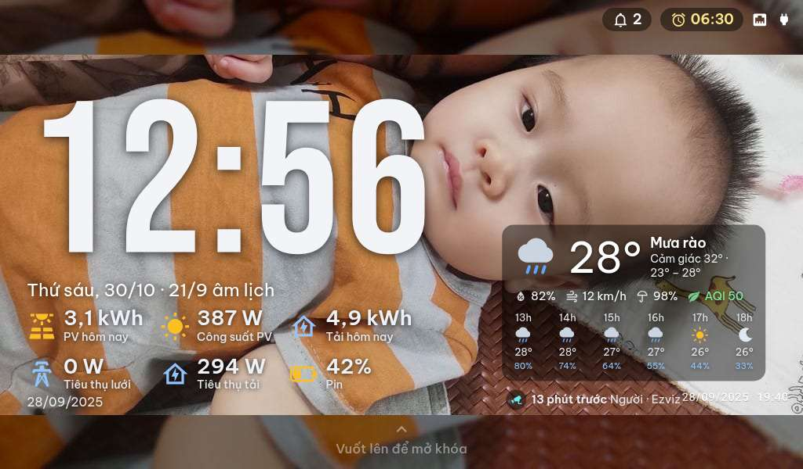

# Dashboard OS — biến màn hình ESP32 thành bảng điều khiển Home Assistant

**Dashboard OS** truyền giao diện Home Assistant (hoặc bất kỳ trang web nào) xuống màn hình **ESP32-S3 / ESP32-P4**
theo thời gian thực, kèm bộ giao diện kiểu điện thoại: màn hình chính, thanh trạng thái, ứng dụng, thông báo,
chuông cửa, báo thức, tin nhắn, IPTV.

- Cài và cấu hình hoàn toàn bằng giao diện web — không sửa file.
- Mỗi màn hình là một thiết bị trong Home Assistant (nút bấm, thanh trượt, cảm biến).
- Chạy trong mạng nội bộ (LAN/Tailscale), không cần Internet.


---

## 1. Tính năng

### Hiển thị
- Chiếu **dashboard Home Assistant** hoặc URL bất kỳ, nhiều tab cho mỗi màn, chuyển tab tức thì.
- Tự điều chỉnh chất lượng hình và nhịp khung theo mạng; chế độ nửa phân giải khi xem video.
- **Màn hình chờ**: đồng hồ lớn, ngày âm lịch, thời tiết, ảnh gia đình (Google Photos hoặc thư mục media).
- Xoay 0/90/180/270, độ sáng, âm lượng, tắt tiếng, chế độ Không làm phiền.



### Giao diện điện thoại
- Màn hình chính dạng lưới: ẩn/hiện ứng dụng, đổi thứ tự, biểu tượng, màu, gom thư mục.
- Thanh trạng thái (pin, Wi-Fi, giờ), kéo xuống để mở bảng thông báo, khoá màn hình bằng vuốt.
- Ứng dụng gần đây, phím Trở lại / Màn hình chính, cử chỉ vuốt bám theo tay.


### Ứng dụng có sẵn
Camera (xem, chụp, quay lưu thẻ SD), Frigate, IPTV, YouTube, YouTube TV, nhạc, radio, tin tức, lịch, thời tiết,
ảnh, ghi chú, tệp, gọi video giữa các màn, chuông cửa, **báo thức**, tin nhắn nội bộ.

  

### Chuông cửa
Bấm chuông ở cổng → mọi màn đổ chuông, hiện hình người bấm, nói chuyện 2 chiều, mở cổng.
Không ai nghe → thông báo "cuộc gọi nhỡ" kèm ảnh, lưu nhật ký 30 ngày.

### Báo thức
Đặt trên màn hoặc từ trang Dashboard: lặp theo thứ, báo lại, chọn màn nào reo.
Báo thức lưu ở server nên **màn tắt vẫn reo đúng giờ**.


### Tin nhắn nội bộ
Gửi tin, ảnh, video giữa các màn hình và điện thoại; màn hình bắn sự kiện về Home Assistant để báo lên điện thoại.

### Điều khiển từ xa
Trang **Điều khiển** trên điện thoại: xem màn hình trực tiếp, chạm/vuốt, phím **Trở lại / Màn hình chính /
Gần đây / Mở khoá**, chụp màn hình.


## 2. Cần gì để bắt đầu

| Thành phần | Yêu cầu |
|---|---|
| Home Assistant | HA OS hoặc Supervised, kiến trúc **amd64** |
| Màn hình | ESP32-S3 / ESP32-P4 đã nạp firmware Dashboard OS |
| Mạng | Màn hình và Home Assistant cùng một mạng LAN |

## 3. Cài đặt (5 phút)

1. **Settings → Add-ons → Add-on Store → ⋮ → Repositories** → dán
   `https://github.com/minhquanghp86/DashboardOS-Server` → **Add**.
2. Tìm **Dashboard OS Server** → **Install** → **Start**.
3. Bật **Show in sidebar**. Thanh bên xuất hiện mục **Dashboard**.
4. Nạp firmware cho màn hình (repo `DashboardOS-Client`, chọn YAML theo loại màn).
   Lần đầu màn hình phát Wi-Fi riêng `dashboard-…` để nhập Wi-Fi nhà.
5. Mở **Dashboard → Màn hình**: màn hình vừa kết nối xuất hiện trong danh sách.


## 4. Sử dụng hằng ngày

### Trên điện thoại (trang Dashboard)
- **Màn hình**: trạng thái từng màn (đang mở gì, pin, Wi-Fi, độ sáng), mở/sửa ứng dụng, đổi Wi-Fi,
  độ sáng, chất lượng hình.
- **Điều khiển**: xem và thao tác màn hình từ xa.
- **Báo thức**, **Tin nhắn**, **IPTV**, **Quản lý file** (thẻ SD), **Chuông cổng**, **Gọi video**.
- **Menu ứng dụng**: bật/tắt, sắp xếp, đổi biểu tượng/màu cho lưới ứng dụng của từng màn.


### Trên màn hình
- Vuốt từ đáy lên: về màn hình chính. Vuốt từ mép trái/phải: quay lại.
- Chạm để mở ứng dụng; giữ để sắp xếp lưới.
- Cài đặt màn hình: Wi-Fi, độ sáng, màn hình chờ, âm thanh.

## 5. Dùng với Home Assistant (tích hợp Dashboard OS)

Mỗi màn hình là một thiết bị trong HA:

| Loại | Dùng để |
|---|---|
| Cảm biến | Màn có kết nối không, đang mở ứng dụng gì, đang khoá / màn hình chờ / đang dùng |
| Nút bấm | Về màn hình chính, quay lại, ứng dụng gần đây, đánh thức, tải lại, chụp màn hình |
| Công tắc | Màn hình chờ, Không làm phiền, giữ màn luôn sáng |
| Thanh trượt | Độ sáng, âm lượng, chất lượng hình |
| Chọn | Góc xoay 0/90/180/270 |

### Cài tích hợp
1. HACS → **Integrations** → ⋮ → **Custom repositories** → dán repo này, chọn *Integration* → **Add**.
2. **Dashboard OS** → **Download** → **Restart Home Assistant**.
3. **Settings → Devices & Services → + Add Integration → Dashboard OS** → giữ địa chỉ mặc định → **Submit**.

### Thông báo từ automation

```yaml
action:
  - action: dashboard_os.send
    data:
      title: "Chuông cổng"
      message: "Có người bấm chuông"
      camera: camera.chuong_cua
      duration: 30
      priority: urgent
```

| Mức ưu tiên | Hành vi |
|---|---|
| `urgent` (mặc định) | Mở khoá màn, bật đèn nền, phủ toàn màn hình |
| `critical` | Như urgent, hiện cả khi đang Không làm phiền |
| `high` | Phủ toàn màn, tôn trọng Không làm phiền |
| `normal` | Chỉ hiện thẻ thông báo |

### Ví dụ khác

```yaml
- action: dashboard_os.open_url          # mở dashboard buổi sáng
  target: { device_id: <id màn hình> }
  data: { url: "http://192.168.10.2:8123/dashboard-mobile/3" }

- action: dashboard_os.say               # đọc thông báo bằng giọng nói
  target: { device_id: <id màn hình> }
  data: { message: "Đã bật máy lạnh" }

- action: dashboard_os.set_quality       # giảm chất lượng khi mạng yếu
  target: { device_id: <id màn hình> }
  data: { quality: 40 }

- action: dashboard_os.alarm_create      # đặt báo thức cho một màn
  target: { device_id: <id màn hình> }
  data: { time: "06:30", days: [1,2,3,4,5], label: "Dậy đi học", snooze: 10 }
```

Danh sách đầy đủ **30 hành động**: [custom_components/dashboard_os/README.md](custom_components/dashboard_os/README.md).
Blueprint sẵn có (thông báo, nhắc lịch, chào buổi sáng, camera, chuông cổng, cảnh báo an ninh):
repo `DashboardOS-Client` → `examples/home-assistant/`.

## 6. Vận hành

| Việc | Ở đâu |
|---|---|
| Xem/sửa từng màn | Sidebar → Dashboard → Màn hình |
| Đổi Wi-Fi, độ sáng, chất lượng | Trên màn hình (Cài đặt) hoặc trang Dashboard |
| Sao lưu | Sao lưu add-on trong Home Assistant |
| Nhật ký | Settings → Add-ons → Dashboard OS Server → Log |

Cổng dùng trong LAN: `18080` (web, điều khiển) và `8081` (màn hình kết nối).

## 7. Xử lý sự cố

| Hiện tượng | Cách xử lý |
|---|---|
| Màn hình không hiện trong danh sách | Kiểm tra cùng mạng Wi-Fi và đúng IP máy HA; khởi động lại màn |
| Hình giật hoặc mờ | Giảm **Chất lượng hình**, hoặc bật nửa phân giải cho video |
| Màn hình đen sau khi cập nhật | Khởi động lại add-on, xem Log |
| Không điều khiển được từ điện thoại | Mở bằng IP LAN (`http://<ip-ha>:18080`), không qua tên miền |
| Báo thức không reo | Kiểm tra màn có trong danh sách "Reo trên" của báo thức |

## 8. Giấy phép

Apache-2.0 — xem [LICENSE](LICENSE), [NOTICE](NOTICE), [THIRD-PARTY-NOTICES.md](THIRD-PARTY-NOTICES.md).
Nhãn hiệu: [TRADEMARKS.md](TRADEMARKS.md).
